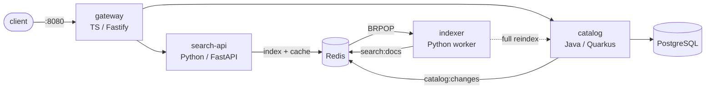

# IncidentLens — AIOps incident-triage platform

A production-style Kubernetes platform, built from code, observed with
OpenTelemetry, broken on purpose with chaos experiments, and triaged by an LLM
agent that is measured against plain threshold alerts and a rule-based baseline.

[](https://github.com/bachcodingg/AIOps-Incident-Triage-Platform/actions/workflows/ci.yml)

## Results

Not measured yet. The evaluation runs in week 10 on a locked test set of 40+
injected incidents; the plan and targets are fixed in advance in
[docs/design.md](docs/design.md#6-evaluation-plan).

| Variant | Detection recall | MTTD | RCA top-1 | Action accuracy | Cost / incident |
|---|---|---|---|---|---|
| B1 static thresholds | – | – | – | – | – |
| B2 burn-rate + rule RCA | – | – | – | – | – |
| A1 burn-rate + anomaly + LLM agent | – | – | – | – | – |

## Architecture



Five layers: workload (above), platform (Terraform, ArgoCD), observability
(OpenTelemetry, Prometheus, Loki, Tempo, Sloth SLOs), chaos (Chaos Mesh,
sealed ground truth) and the AIOps loop (detectors, correlator, triage agent,
gated remediator). Details: [docs/design.md](docs/design.md).

## Quickstart (kind, free)

Requirements: Docker with 8 GB of memory, `make`, `bash`, `curl`, `python3`.
`kind`, `kubectl` and `helm` are downloaded into `.bin/` if they are not on
your PATH.

```bash
git clone https://github.com/bachcodingg/AIOps-Incident-Triage-Platform.git
cd AIOps-Incident-Triage-Platform
make up          # kind + build + ArgoCD sync + end-to-end smoke test
curl 'http://localhost:8080/api/search?q=gaming%20lapotp'
make canary-test # a good release is promoted, a bad one aborts on its own
make obs-test    # a request followed from the gateway to its database span
make chaos-test FAULT=F12   # break it on purpose: one fault, its symptom, recovery
make grafana     # Grafana on http://localhost:3000 and its admin password
make down        # delete the cluster
```

`make up` deploys the same charts through ArgoCD as a cloud cluster does, so
ArgoCD follows your current branch **on GitHub**: push before you run it. All
three tests run in the [`e2e` CI job](.github/workflows/ci.yml) on every pull
request. If port 8080 or 3000 is taken, use `make up HOST_PORT=8088
GRAFANA_PORT=3001` on a new cluster. With less than 8 GB for Docker, the CI job
is the place to run the whole stack. Other targets: `make help`.

For the cloud: `make cloud` builds EKS and `make destroy` removes it again and
proves nothing billable is left. See [infra/README.md](infra/README.md).

On Windows, run it from Git Bash (`winget install ezwinports.make` provides
`make`).

## Repository layout

| Path | What |
|---|---|
| [`services/`](services/) | ShopSearch: gateway, search-api, catalog, indexer |
| [`infra/`](infra/) | Terraform modules for AWS EKS and OCI, Terragrunt environments, kind |
| [`gitops/`](gitops/) | Helm charts, ArgoCD app-of-apps, Argo Rollouts canaries, Kyverno policies, SLOs and dashboards |
| [`chaos/`](chaos/) | fault catalog (F01–F14), Chaos Mesh experiments, and `chaos-runner`, which injects them and seals the ground truth |
| [`aiops/`](aiops/) | detectors, correlator, triage agent, remediator (weeks 6–9) |
| [`eval/`](eval/) | evaluation harness and results (weeks 6–10) |
| [`docs/`](docs/) | design doc, [runbooks](docs/runbooks/) for every fault; postmortems later |

## Roadmap

- [x] **Week 1 — Foundations:** monorepo, design doc, 4 services with health endpoints, Dockerfiles and unit tests, `make up` on kind
- [x] **Week 2 — Terraform (code):** remote state, network/cluster/registry/iam modules for OCI and AWS EKS, infra CI. The recorded apply and destroy on a real account are still to do, see [infra/README.md](infra/README.md#what-was-verified-and-what-was-not)
- [x] **Week 3 — GitOps:** Helm charts, ArgoCD, signed images, Argo Rollouts canaries, Kyverno ([how a commit reaches production](gitops/README.md#from-commit-to-production))
- [x] **Week 4 — Observability and SLOs (gate G1):** OpenTelemetry in all 4 services, collector agent and gateway, Prometheus, Loki, Tempo and Grafana through ArgoCD, Sloth SLOs with burn-rate alerts, RED, SLO and cost dashboards, a daily k6 load curve. `make obs-test` follows a request from the gateway to its database span ([how](gitops/README.md#following-a-request))
- [x] **Week 5 — Chaos and runbooks:** the 14 faults as Chaos Mesh experiments, bad releases and load, `chaos-runner` with a seeded random schedule and hash-chained sealed labels, a runbook per fault, and a dry run in CI that proves each fault's symptom on its own cluster ([how faults are injected](chaos/README.md))
- [ ] Week 6 — Detection, correlation, dataset recording (**gate G2**)
- [ ] Week 8 — Triage agent
- [ ] Week 9 — Remediation and console
- [ ] Week 10 — Evaluation runs (**gate G3**)
- [ ] Week 11 — Write-up

## Cost

Low-cost path, target ≤ 10 in total: kind for development and the dataset,
an OCI Always Free VM for the always-on demo, AWS EKS only in a few recorded
sessions on free credits, GitHub Actions and GHCR for CI, a local or free-tier
LLM for tuning and one paid model only for the final A1 test runs. See
[docs/design.md §7](docs/design.md#7-environments-and-cost-low-cost-path).

## License

[MIT](LICENSE)
