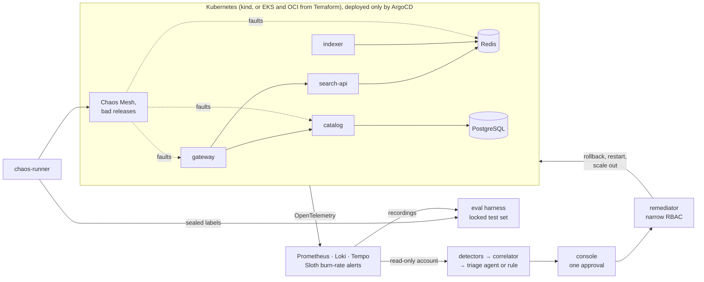

# IncidentLens — AIOps incident-triage platform

A production-style Kubernetes platform, built from code, observed with
OpenTelemetry, broken on purpose with chaos experiments, and triaged by an LLM
agent that is measured against plain threshold alerts and a rule-based baseline.

[](https://github.com/bachcodingg/AIOps-Incident-Triage-Platform/actions/workflows/ci.yml)

## Results

<!-- results:start -->
Not measured yet. The evaluation runs once, on a locked test set of 40+
injected incidents, after the dataset is recorded (gate G2); the plan and
targets are fixed in advance in
[docs/design.md](docs/design.md#6-evaluation-plan). `make results` replaces
this block.

| Variant | Detection recall | MTTD | RCA top-1 | Action accuracy | Cost / incident |
|---|---|---|---|---|---|
| B0 static thresholds | – | – | – | – | – |
| B1 SLO burn-rate alerts | – | – | – | – | – |
| B2 burn-rate + anomaly + rule RCA | – | – | – | – | – |
| A1 burn-rate + anomaly + LLM agent | – | – | – | – | – |
<!-- results:end -->

On <!-- n:faults -->–<!-- /n --> held-out incidents, the agent (A1) named the
root cause in <!-- n:triage.A1.top1 -->–<!-- /n --> of them against
<!-- n:triage.B2.top1 -->–<!-- /n --> for the rule baseline (B2; McNemar
p = <!-- n:mcnemar.p -->–<!-- /n -->), with
<!-- n:triage.A1.unsafe -->–<!-- /n --> unsafe actions at
<!-- n:triage.A1.cost -->–<!-- /n --> per incident. With one approval per fix,
median time to recover changed by <!-- n:mttr.change -->–<!-- /n --> in the
live test. "–" means not measured yet; every number in this README and the
blog post is filled from [eval/results.json](eval/results.json), and CI checks
that they match.

**Demo (3 min):** not recorded yet. The shot list is in [docs/demo.md](docs/demo.md).

## Architecture



The workload is ShopSearch: four services in TypeScript, Python and Java over
PostgreSQL and Redis. Around it are the platform (Terraform, ArgoCD, Argo
Rollouts canaries, Kyverno), observability (OpenTelemetry, Prometheus, Loki,
Tempo, Sloth SLOs), chaos (14 fault types, ground truth sealed where the AIOps
layer cannot read it) and the AIOps loop. Request paths, dependencies and
every decision: [docs/design.md](docs/design.md).

## Quickstart (kind, free)

Requirements: Docker with 8 GB of memory, `make`, `bash`, `curl`, `python3`.
`kind`, `kubectl` and `helm` are downloaded into `.bin/` if they are not on
your PATH.

```bash
git clone https://github.com/bachcodingg/AIOps-Incident-Triage-Platform.git
cd AIOps-Incident-Triage-Platform
make up          # kind + build + ArgoCD sync + end-to-end smoke test
curl 'http://localhost:8080/api/search?q=gaming%20lapotp'
make canary-test # a good release is promoted, a bad one aborts on its own
make obs-test    # a request followed from the gateway to its database span
make chaos-test FAULT=F12   # break it on purpose: one fault, its symptom, recovery
make detect-test # detectors and the read-only aiops account on the live cluster
make remediate-test # the remediator's rights, and its patches dry-run
make demo-fault  # with `make console` running: the demo video's bad release
make console     # live loop and operator console on http://127.0.0.1:8090
make grafana     # Grafana on http://localhost:3000 and its admin password
make down        # delete the cluster
```

`make up` deploys the same charts through ArgoCD as a cloud cluster does, so
ArgoCD follows your current branch **on GitHub**: push before you run it. The
canary, observability and detection tests run in the [`e2e` CI job](.github/workflows/ci.yml) on every pull
request. If port 8080 or 3000 is taken, use `make up HOST_PORT=8088
GRAFANA_PORT=3001` on a new cluster. With less than 8 GB for Docker, the CI job
is the place to run the whole stack. Other targets: `make help`.

For the cloud: `make cloud` builds EKS and `make destroy` removes it again and
proves nothing billable is left. See [infra/README.md](infra/README.md).

On Windows, run it from Git Bash (`winget install ezwinports.make` provides
`make`).

## Read more

| | |
|---|---|
| [Design doc](docs/design.md) | goals, SLOs, the evaluation plan and targets fixed in advance, one section per week |
| [Runbooks](docs/runbooks/) | one per fault type; the triage agent can read them (A3 is without) |
| [Postmortems](docs/postmortems/) | blameless, for the live test's most interesting incidents |
| [Results](eval/results.md) | every metric with 95% intervals, McNemar A1 vs B2, ablations, confusion by fault type |
| [Blog post](docs/blog.md) | what worked, what failed, what it cost (draft until the results are in) |
| [Evaluation harness](eval/README.md) | how the dataset was frozen, run and scored |

## What did not work

<!-- wrong:start -->
Not measured yet. `make results` lists here the fault types the agent got
wrong in at least half its runs on the test set.
<!-- wrong:end -->

## Repository layout

| Path | What |
|---|---|
| [`services/`](services/) | ShopSearch: gateway, search-api, catalog, indexer |
| [`infra/`](infra/) | Terraform modules for AWS EKS and OCI, Terragrunt environments, kind |
| [`gitops/`](gitops/) | Helm charts, ArgoCD app-of-apps, Argo Rollouts canaries, Kyverno policies, SLOs and dashboards |
| [`chaos/`](chaos/) | fault catalog (F01–F14), Chaos Mesh experiments, and `chaos-runner`, which injects them and seals the ground truth |
| [`aiops/`](aiops/) | telemetry recorder, detectors and correlator (week 6), triage agent and rule baseline (week 8), remediator, live loop and console (week 9) |
| [`eval/`](eval/) | evaluation harness and results (weeks 6–10), and the write-up's numbers (week 11) |
| [`docs/`](docs/) | design doc, [runbooks](docs/runbooks/), [postmortems](docs/postmortems/), the [blog post](docs/blog.md) and the [demo script](docs/demo.md) |

## Roadmap

- [x] **Week 1 — Foundations:** monorepo, design doc, 4 services with health endpoints, Dockerfiles and unit tests, `make up` on kind
- [x] **Week 2 — Terraform (code):** remote state, network/cluster/registry/iam modules for OCI and AWS EKS, infra CI. The recorded apply and destroy on a real account are still to do, see [infra/README.md](infra/README.md#what-was-verified-and-what-was-not)
- [x] **Week 3 — GitOps:** Helm charts, ArgoCD, signed images, Argo Rollouts canaries, Kyverno ([how a commit reaches production](gitops/README.md#from-commit-to-production))
- [x] **Week 4 — Observability and SLOs (gate G1):** OpenTelemetry in all 4 services, collector agent and gateway, Prometheus, Loki, Tempo and Grafana through ArgoCD, Sloth SLOs with burn-rate alerts, RED, SLO and cost dashboards, a daily k6 load curve. `make obs-test` follows a request from the gateway to its database span ([how](gitops/README.md#following-a-request))
- [x] **Week 5 — Chaos and runbooks:** the 14 faults as Chaos Mesh experiments, bad releases and load, `chaos-runner` with a seeded random schedule and hash-chained sealed labels, a runbook per fault, and a dry run in CI that proves each fault's symptom on its own cluster ([how faults are injected](chaos/README.md))
- [ ] **Week 6 — Detection and correlation (gate G2):** static-threshold rules with promtool tests, burn-rate alerts labelled as a detector, anomaly detection (rolling MAD, Isolation Forest, missing telemetry), a correlator over the static and Tempo service graphs, a recorder that reads as a read-only account blind to the chaos namespace, and a freeze that hash-locks the test set. The code is done and tested; gate G2 waits for the recording itself, about 6 days of laptop time ([steps](docs/design.md#11-detection-and-correlation-week-6))
- [x] **Week 7 — Buffer:** the plan's catch-up week. The Kyverno policies moved from the deprecated `ClusterPolicy` to the CEL types (`ValidatingPolicy`, `ImageValidatingPolicy`), with denials that name the failing image or container ([policies](gitops/README.md#policies))
- [ ] **Week 8 — Triage agent:** an LLM agent with 8 read-only, typed tools and hard limits per incident, replaying recorded incidents with nothing visible after triage time; strict JSON verdicts (retry once, then escalate); the rule baseline in the same format; A1 to A4 variants and the tuning-set scorer. Code done and tested on synthetic recordings with a scripted model; tuning waits for the gate G2 dataset ([design](docs/design.md#12-triage-agent-week-8))
- [ ] **Week 9 — Remediation and console:** a live loop on the cluster (detect, correlate, triage, decide), a remediator with its own narrow RBAC (rollback through Argo Rollouts or ArgoCD, restart, scale out), automatic only for a canary in progress and one approval for the rest, a React console with evidence, Grafana links and a hash-chained audit log, and `make mttr` for the live test. Code done and tested; the 10-incident live test and the video need a running cluster ([design](docs/design.md#13-remediation-and-the-console-week-9))
- [ ] **Week 10 — Evaluation runs (gate G3):** `make eval-final` runs every detector and triage variant on the locked test set once, 3 seeds, under one spending cap, after writing a G3 lock with the hash of every prompt, model, detector and scorer (a resumed run refuses a changed system, and CI fails a change to a frozen file); `make results` writes eval/results.md, the charts and this README's table: targets met or missed, bootstrap CIs over incidents, McNemar A1 vs B2, ablations, confusion by fault type. Code done and tested on synthetic data; the run waits for the gate G2 dataset ([design](docs/design.md#14-evaluation-runs-week-10))
- [ ] **Week 11 — Write-up:** this README in the plan's order (results, demo, architecture, quickstart, links, what did not work), a blog draft, the demo shot list and `make demo-fault`, `make postmortem` drafting blameless postmortems from a live test's audit log and labels, and `make writeup`, which fills every number in the README, the blog and the CV entry from eval/results.json, checked in CI. Waits for the numbers, like weeks 8 to 10; the video, the postmortems' analysis and publishing are by hand ([design](docs/design.md#15-write-up-week-11))

## Cost

Low-cost path, target ≤ 10 in total: kind for development and the dataset,
an OCI Always Free VM for the always-on demo, AWS EKS only in a few recorded
sessions on free credits, GitHub Actions and GHCR for CI, a local or free-tier
LLM for tuning and one paid model only for the final A1 test runs. See
[docs/design.md §7](docs/design.md#7-environments-and-cost-low-cost-path).

## License

[MIT](LICENSE)
