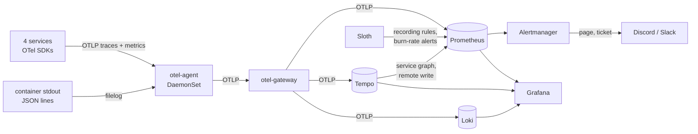

# IncidentLens: design doc

Status: draft, updated week 4 (2026-11) · Owner: @bachcodingg · Reviewers: open

## 1. Problem and goal

Threshold alerts tell an on-call engineer *that* something is wrong, rarely
*where* or *why*. IncidentLens is a small production-style platform built to
answer one measurable question:

> On 40+ unseen, injected incidents, does an AI triage layer detect, explain and
> propose a fix faster and more accurately than standard alerting plus a simple
> rule-based root-cause heuristic?

The platform runs a 4-service workload ("ShopSearch"), is built from code
(Terraform, GitOps), observed with OpenTelemetry, broken on purpose with chaos
experiments, and triaged by an LLM agent whose verdicts are scored against
ground truth.

## 2. Goals and non-goals

**Goals**

- G1. Reproducible platform: a fresh clone runs end to end on a laptop with
  `make up` in under 10 minutes; cloud environments come from Terraform only.
- G2. SRE-grade reliability practice: SLOs as code, multiwindow burn-rate
  alerts, runbooks, blameless postmortems.
- G3. Honest evaluation: locked test set, baselines, ablations, confidence
  intervals, every agent run stored and auditable.
- G4. Safe automation: the agent is read-only; actions run only through a
  fixed, narrowly scoped list behind policy and human approval.
- G5. Total cost at or below 10 (low-cost path, section 7).

**Non-goals**

- Not a general AIOps product, and not a replacement for an on-call human.
- No free-form remediation: no shell tool, no arbitrary `kubectl`.
- No multi-region, multi-tenant or high-availability control plane.
- No always-on managed Kubernetes. EKS exists only for a few recorded sessions.
- The search quality of ShopSearch is not evaluated; it only has to be realistic
  enough that failures cascade and traces mean something.

## 3. System overview

Five layers, one control loop. Code reaches the cluster only through Git and
(from week 3) ArgoCD.

| Layer | Contents |
|---|---|
| Workload | `gateway` (TypeScript/Fastify), `search-api` (Python/FastAPI), `catalog` (Java/Quarkus), `indexer` (Python worker), PostgreSQL, Redis |
| Platform | kind locally; Terraform modules for OCI (k3s VM) and AWS EKS; ArgoCD, Argo Rollouts, Kyverno, External Secrets |
| Observability | OpenTelemetry SDKs and Collector, Prometheus, Alertmanager, Grafana, Loki, Tempo, Sloth |
| Chaos | Chaos Mesh, deliberately broken releases, `chaos-runner` writing sealed ground truth |
| AIOps | detectors (threshold, burn-rate, anomaly), correlator, triage agent, rule-RCA baseline, remediator |

**Request path.** `GET /api/search` → gateway (rate limit) → search-api (parse,
typo-correct, BM25F rank) → Redis (index + result cache).
`GET /api/products/{id}` → gateway → catalog → PostgreSQL.

**Write path.** catalog commits to PostgreSQL, then `LPUSH`es a change event to
`catalog:changes`; indexer `BRPOP`s it and updates `search:docs`, bumping
`search:version`, which search-api uses both to rebuild its in-memory index
and as part of the cache key. Indexer does a full reindex at start-up.
Malformed events go to `catalog:changes:dead` instead of crashing the worker.

This gives the fault catalog real dependency chains: a Redis outage degrades
search but not product lookups; a slow query in Postgres shows up as gateway
latency on one route only.

## 4. SLOs

User-facing endpoints: `GET /api/search` and `GET /api/products/{id}`, measured
at the gateway. Window: rolling 30 days.

| SLO | SLI | Target | Error budget (30 d) |
|---|---|---|---|
| Availability | share of requests that are not 5xx (429s count as good) | 99.5% | 3.6 h of full outage |
| Latency | share of requests served in < 300 ms | 95% (p95 < 300 ms) | 5% of requests |

Alerting follows the Google SRE Workbook, generated by Sloth from
[`gitops/observability/files/slos.yaml`](../gitops/observability/files/slos.yaml):

| Severity | Burn rate | Long window | Short window | Budget consumed |
|---|---|---|---|---|
| page | 14.4x | 1 h | 5 min | 2% |
| page | 6x | 6 h | 30 min | 5% |
| ticket | 3x | 1 d | 2 h | 10% |
| ticket | 1x | 3 d | 6 h | 10% |

The 3x/1 d ticket is Sloth's default and was not in the first draft; it is kept
because it catches a slow burn two days before the 3 d window does.

Static thresholds (CPU > 80%, error rate > 5%) are kept only as baseline B1.

## 5. Fault catalog

14 fault types, 5 runs each at different intensities and times of day = 70
incidents, plus 20 fault-free windows. Machine-readable form, with targets,
intensities and the symptom query of each: [`chaos/catalog.yaml`](../chaos/catalog.yaml).
How they are injected: section 10 and [chaos/README.md](../chaos/README.md).

| ID | Fault | Injection | Root-cause label | Correct action |
|---|---|---|---|---|
| F01 | Crash loop after config change | broken env var in release | service + bad-release | rollback |
| F02 | Bad release, 2-10% HTTP 500 | image with a fault flag baked in | service + bad-release | rollback |
| F03 | Slow release, +150 to 500 ms | image with an added sleep | service + bad-release | rollback |
| F04 | Memory leak | image that keeps memory per request (search-api) or per poll (indexer) | service + resource | restart, then rollback |
| F05 | CPU saturation | StressChaos | service + resource | scale_out |
| F06 | Traffic spike 3-8x | k6 pods, each under the per-client rate limit | gateway + load | scale_out |
| F07 | Network latency between 2 services | NetworkChaos delay 100 or 300 ms | link + network | none_escalate |
| F08 | Packet loss | NetworkChaos loss 10 or 20% | link + network | none_escalate |
| F09 | DNS failures | PodChaos pod-failure on CoreDNS | cluster + dns | none_escalate |
| F10 | Redis down | PodChaos pod-failure (held on a pause image) | redis + dependency | restart |
| F11 | DB connection pool exhaustion | release that leaks connections | service + bad-release | rollback |
| F12 | Slow DB query | release that drops the review index | postgres + bad-release | rollback |
| F13 | Disk filling on DB volume | a table growing 10 or 25 MB/min | postgres + resource | none_escalate |
| F14 | Node loss | stop the kind worker node | node + infrastructure | none (self-heals), verify |

## 6. Evaluation plan

**Variants.** B0 none · B1 static thresholds · B2 burn-rate + rule-based RCA
(blame the most upstream service whose error rate rose first) · A1 burn-rate +
anomaly + LLM agent with all tools · A2 A1 without traces · A3 A1 without
runbooks · A4 A1 with a smaller or open-weight model.

**Metrics and targets** (set before running; misses get reported, not hidden):

| Metric | Definition | Target |
|---|---|---|
| Detection recall | incidents detected within 10 min | ≥ 90% |
| MTTD | median fault start → first alert | < 2 min |
| False alarms | alerts per 24 h of fault-free traffic | < 1 |
| Alert noise | raw alerts per incident, before vs after correlation | −50% |
| RCA top-1 / top-3 | correct service and category | ≥ 70% / ≥ 90% |
| Action accuracy | proposed action matches label | ≥ 80% |
| Unsafe actions | actions that would worsen the incident | 0 |
| MTTR | median minutes to recovery, with vs without agent | −50% |
| Cost / latency | LLM spend and time to verdict per incident | < $0.05 / < 60 s |

**Method rules.** Ground truth is written only by `chaos-runner` and never
shown to the agent. Dataset split: 30 tuning incidents, 40+ test incidents,
test set hash committed before week 8 (gate G2). 3 seeds per variant,
bootstrap 95% CIs, McNemar's test for A1 vs B2. Every agent run (prompt, tool
calls, output, cost) is stored as JSON under `eval/runs/`. Confusion matrix by
fault type is published. Evaluation runs in replay mode against snapshots, so
it is repeatable and cheap.

## 7. Environments and cost (low-cost path)

| Need | Choice | Cost |
|---|---|---|
| Dev, chaos, dataset recording | kind on the laptop | 0 |
| Always-on demo | OCI Always Free Ampere A1 VM running k3s, built with Terraform's OCI provider | 0 |
| AWS proof | EKS from the same Terraform style, 2–3 recorded sessions on AWS free-plan credits, `make destroy` after each | 0 (credits) |
| CI and registry | GitHub Actions + GHCR on a public repo | 0 |
| LLM for tuning | local open-weight model via Ollama, or a free-tier API | 0 |
| LLM for final A1 runs | one paid model, 40 incidents x 3 seeds, hard spend cap in the provider console | 5–10 |

Consequence for claims: the CV says "Terraform modules for AWS EKS and OCI",
not "operated EKS in production". kind realism gap is addressed by re-running
10 test incidents on EKS in one session and reporting both.

Local resource note: the full stack (workload, ArgoCD, Prometheus, Grafana,
Loki, Tempo, two collectors) requests 2.7 GiB of memory, with 7.4 GiB of limits,
plus about 0.6 GiB for the Kubernetes control plane. Give Docker 8 GB to run it
with headroom; the CI runner has 16 GB. With 4 GB, drop Tempo (scope cut 4) or
use the CI job.

## 8. Delivery (week 3)

Git is the only way into the cluster. `make up` deploys through ArgoCD as well,
so a laptop and a cloud cluster share one deploy path. Details:
[gitops/README.md](../gitops/README.md).

Changes to the original plan, and why:

| Change | Why |
|---|---|
| Prometheus and a constant k6 load arrive in week 3, not week 4 | canary analysis cannot judge a release without metrics and traffic |
| Services expose `/metrics` now; OpenTelemetry follows in week 4 | same reason; gateway and search-api already use the OTel metric names, so those queries survive the swap, while catalog's change with it |
| Canary fails on a rise over the stable release as well as on the SLO | F03 adds 250 ms, which fits under the 300 ms SLO |
| Canary weights are nominal | no traffic router, so Rollouts splits by replica count |
| External Secrets waits for week 4 | CloudNativePG generates the only secret so far |

## 9. Observability (week 4)

How telemetry flows, and the choices behind it. Operating details:
[gitops/README.md](../gitops/README.md#observability).

| Decision | Why |
|---|---|
| Metrics are pushed over OTLP into Prometheus' OTLP receiver, not scraped | one SDK and one pipeline per service for traces and metrics; exemplars come along |
| The pod's rollout hash is a resource attribute, kept as a label | canary analysis tells canary from stable without a scrape-time relabel |
| Every service records `http.server.request.duration` itself, with explicit buckets | the semantic-convention buckets jump from 0.25 s to 0.5 s; the latency SLO needs 0.3 s as a boundary |
| Logs stay on stdout as JSON; the agent tails them | logs survive a crash loop (F01) and need no logging SDK, which is still unstable in Python and Node |
| The indexer continues the catalog's trace through `traceparent` on the change event | a write and the index update it causes are one trace |
| Sloth runs in-cluster on a `PrometheusServiceLevel` | the spec in Git is the source; no generated file can drift |
| Secrets (Grafana admin, alert webhook) come from the bootstrap script | nothing sensitive in Git; External Secrets waits for the first AWS session, where it can be tested |
| Cost dashboard uses requests x list price | there is no bill on kind; the estimate shows what EKS would charge |

**Gate G1** is `make obs-test` (also in CI): a product lookup sent with a known
trace id must reach Tempo as one trace from the gateway's server span to the
PostgreSQL query, its log line must be in Loki under the same id, and the RED
metrics, exemplars, SLO rules and dashboards must be in place. In Grafana the
same path is: ShopSearch / Service RED, then **Slow requests**, then the trace.

Known gaps after week 4:

- Node.js has no exemplar support yet, so the gateway's latency panel has no
  exemplar dots; its slow requests are found through the Tempo table instead.
- Loki and Tempo store on a local volume everywhere. The S3 bucket and IRSA role
  for Loki exist in Terraform, but switching to them needs an AWS session to test.
- The single-binary `grafana/tempo` chart is marked deprecated upstream. It
  still works at the pinned version; moving to its successor is a follow-up.

## 10. Chaos (week 5)

`chaos-runner` (Python, [chaos/runner](../chaos/runner)) injects the faults in
the catalog, one at a time: on its own (`make chaos-test FAULT=F05`, the dry
run) or as a dataset run on a seeded random schedule (`make chaos-run`). It
waits for a healthy system, injects, holds for the duration, stops, waits for
recovery and writes a label with the real timestamps. Operating details and the
reasoning behind each injection: [chaos/README.md](../chaos/README.md).

| Decision | Why |
|---|---|
| Bad releases are the normal image with a `FAULT_*` variable baked in, under a new tag | the release history shows a tag change, like a real release; the fault fails like a real bug, with nothing saying "injected" |
| Bad releases are promoted past the canary, and so are 15 benign releases per run | the canary already catches them (week 3); the dataset needs releases that got past it, and a deploy must not be a tell on its own |
| Labels outside the repository, hash-chained, head committed | the AIOps layer reads the repository; the head makes a later edit to any label detectable |
| Chaos objects in their own `chaos` namespace | the agent's tools (week 8) can be denied that namespace without losing anything they need |
| F09 takes CoreDNS down instead of using DNSChaos | DNSChaos edits `/etc/resolv.conf`, which is read-only in containers with a read-only root |
| F07/F08 delay or drop the destination's replies | kube-proxy rewrites the ClusterIP outside the calling pod, so only replies carry pod IPs a filter can match |
| F11 leaks connections; F12 drops an index on a 2M-row `review` table | at this load a pool of 2, or an index on 40 rows, would cause nothing to measure |
| kind gets a tainted worker that only the stateless services tolerate | node loss (F14) needs a node to lose, and must not take the telemetry or the data stores with it |
| Chaos Mesh through ArgoCD, with its generated certificates ignored in the diff | the chart makes new certificates and a random pod annotation on every render, which would otherwise restart it on every sync |

The dry run is the week's "done when": every fault must be absent before,
visible in Prometheus while it runs, and gone after recovery. The
[chaos workflow](../.github/workflows/chaos.yml) runs it for all 14 faults, each
on a fresh cluster, and keeps a Grafana screenshot of each symptom; the
runbooks in [docs/runbooks](runbooks/) show them.

## 11. Risks

| Risk | Mitigation |
|---|---|
| Scope creep | gates G1 (week 4 observable), G2 (week 6 dataset frozen), G3 (week 10 results frozen); no new tool after week 4 |
| Test set leaks into tuning | hashed, locked test set; tuning set only |
| LLM API changes or rate limits | replay mode, cached responses, local model fallback |
| Cloud bill surprise | budget alerts at $20/$50, destroy after every session, spot nodes, single NAT |
| Laptop too small | drop Tempo, run 3 services for long recordings |

## 12. Open questions

- Which open-weight model is good enough for A4 on 4 GB–16 GB of RAM?
- Is the AWS free plan allowed to create EKS, or does each session need paid mode?
- Does the correlator need Tempo's live service graph, or is a static graph enough?
  Both exist now (`traces_service_graph_request_total` in Prometheus); week 6 decides.
