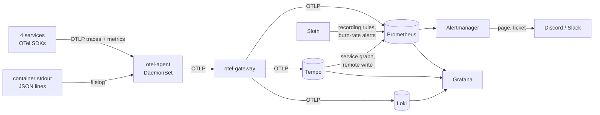
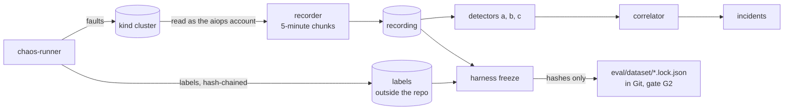
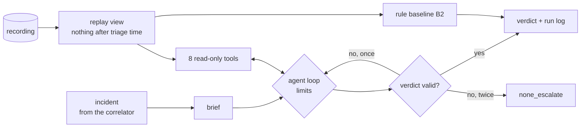
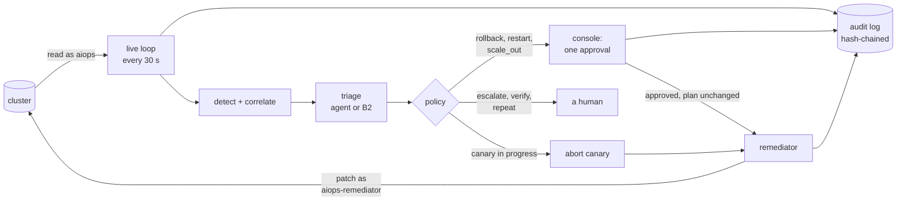
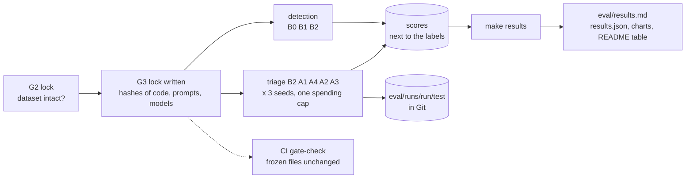
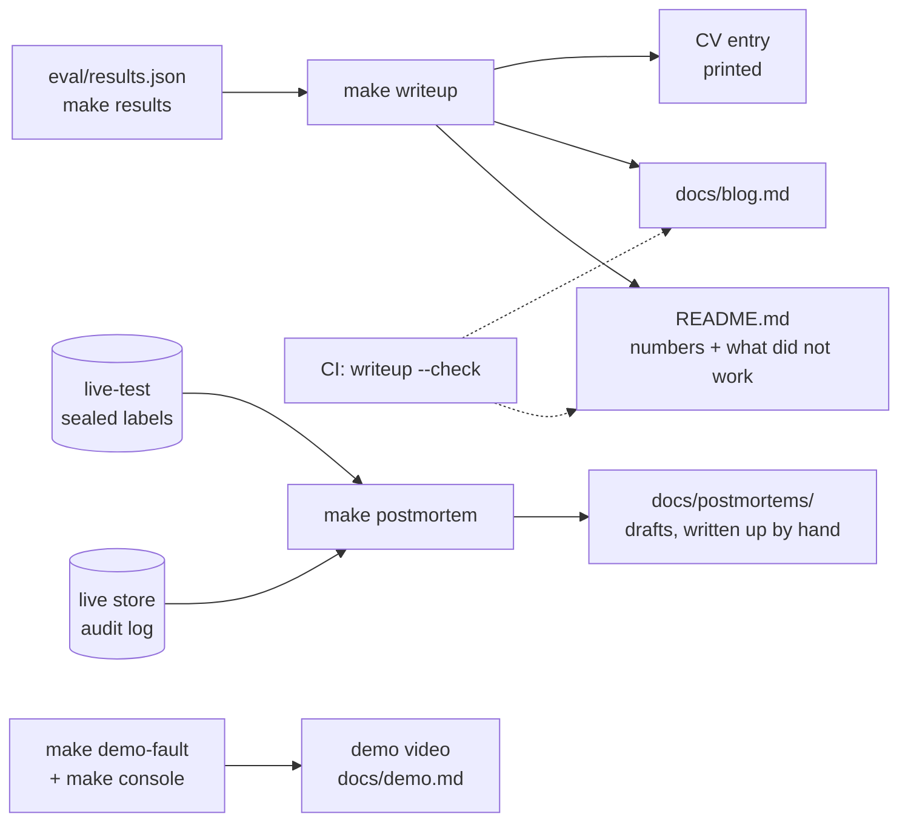

# IncidentLens: design doc

Status: draft, updated week 9 (2026-11) · Owner: @bachcodingg · Reviewers: open

## 1. Problem and goal

Threshold alerts tell an on-call engineer *that* something is wrong, rarely
*where* or *why*. IncidentLens is a small production-style platform built to
answer one measurable question:

> On 40+ unseen, injected incidents, does an AI triage layer detect, explain and
> propose a fix faster and more accurately than standard alerting plus a simple
> rule-based root-cause heuristic?

The platform runs a 4-service workload ("ShopSearch"), is built from code
(Terraform, GitOps), observed with OpenTelemetry, broken on purpose with chaos
experiments, and triaged by an LLM agent whose verdicts are scored against
ground truth.

## 2. Goals and non-goals

**Goals**

- G1. Reproducible platform: a fresh clone runs end to end on a laptop with
  `make up` in under 10 minutes; cloud environments come from Terraform only.
- G2. SRE-grade reliability practice: SLOs as code, multiwindow burn-rate
  alerts, runbooks, blameless postmortems.
- G3. Honest evaluation: locked test set, baselines, ablations, confidence
  intervals, every agent run stored and auditable.
- G4. Safe automation: the agent is read-only; actions run only through a
  fixed, narrowly scoped list behind policy and human approval.
- G5. Total cost at or below 10 (low-cost path, section 7).

**Non-goals**

- Not a general AIOps product, and not a replacement for an on-call human.
- No free-form remediation: no shell tool, no arbitrary `kubectl`.
- No multi-region, multi-tenant or high-availability control plane.
- No always-on managed Kubernetes. EKS exists only for a few recorded sessions.
- The search quality of ShopSearch is not evaluated; it only has to be realistic
  enough that failures cascade and traces mean something.

## 3. System overview

Five layers, one control loop. Code reaches the cluster only through Git and
(from week 3) ArgoCD.

| Layer | Contents |
|---|---|
| Workload | `gateway` (TypeScript/Fastify), `search-api` (Python/FastAPI), `catalog` (Java/Quarkus), `indexer` (Python worker), PostgreSQL, Redis |
| Platform | kind locally; Terraform modules for OCI (k3s VM) and AWS EKS; ArgoCD, Argo Rollouts, Kyverno, External Secrets |
| Observability | OpenTelemetry SDKs and Collector, Prometheus, Alertmanager, Grafana, Loki, Tempo, Sloth |
| Chaos | Chaos Mesh, deliberately broken releases, `chaos-runner` writing sealed ground truth |
| AIOps | detectors (threshold, burn-rate, anomaly), correlator, triage agent, rule-RCA baseline, remediator |

**Request path.** `GET /api/search` → gateway (rate limit) → search-api (parse,
typo-correct, BM25F rank) → Redis (index + result cache).
`GET /api/products/{id}` → gateway → catalog → PostgreSQL.

**Write path.** catalog commits to PostgreSQL, then `LPUSH`es a change event to
`catalog:changes`; indexer `BRPOP`s it and updates `search:docs`, bumping
`search:version`, which search-api uses both to rebuild its in-memory index
and as part of the cache key. Indexer does a full reindex at start-up.
Malformed events go to `catalog:changes:dead` instead of crashing the worker.

This gives the fault catalog real dependency chains: a Redis outage degrades
search but not product lookups; a slow query in Postgres shows up as gateway
latency on one route only.

## 4. SLOs

User-facing endpoints: `GET /api/search` and `GET /api/products/{id}`, measured
at the gateway. Window: rolling 30 days.

| SLO | SLI | Target | Error budget (30 d) |
|---|---|---|---|
| Availability | share of requests that are not 5xx (429s count as good) | 99.5% | 3.6 h of full outage |
| Latency | share of requests served in < 300 ms | 95% (p95 < 300 ms) | 5% of requests |

Alerting follows the Google SRE Workbook, generated by Sloth from
[`gitops/observability/files/slos.yaml`](../gitops/observability/files/slos.yaml):

| Severity | Burn rate | Long window | Short window | Budget consumed |
|---|---|---|---|---|
| page | 14.4x | 1 h | 5 min | 2% |
| page | 6x | 6 h | 30 min | 5% |
| ticket | 3x | 1 d | 2 h | 10% |
| ticket | 1x | 3 d | 6 h | 10% |

The 3x/1 d ticket is Sloth's default and was not in the first draft; it is kept
because it catches a slow burn two days before the 3 d window does.

Static thresholds (CPU > 80%, error rate > 5%, and the like) are kept only as
baseline B0 ([section 11](#11-detection-and-correlation-week-6)).

## 5. Fault catalog

14 fault types, 5 runs each at different intensities and times of day = 70
incidents, plus 20 fault-free windows. Machine-readable form, with targets,
intensities and the symptom query of each: [`chaos/catalog.yaml`](../chaos/catalog.yaml).
How they are injected: section 10 and [chaos/README.md](../chaos/README.md).

| ID | Fault | Injection | Root-cause label | Correct action |
|---|---|---|---|---|
| F01 | Crash loop after config change | broken env var in release | service + bad-release | rollback |
| F02 | Bad release, 2-10% HTTP 500 | image with a fault flag baked in | service + bad-release | rollback |
| F03 | Slow release, +150 to 500 ms | image with an added sleep | service + bad-release | rollback |
| F04 | Memory leak | image that keeps memory per request (search-api) or per poll (indexer) | service + resource | restart, then rollback |
| F05 | CPU saturation | StressChaos | service + resource | scale_out |
| F06 | Traffic spike 3-8x | k6 pods, each under the per-client rate limit | gateway + load | scale_out |
| F07 | Network latency between 2 services | NetworkChaos delay 100 or 300 ms | link + network | none_escalate |
| F08 | Packet loss | NetworkChaos loss 10 or 20% | link + network | none_escalate |
| F09 | DNS failures | PodChaos pod-failure on CoreDNS | cluster + dns | none_escalate |
| F10 | Redis down | PodChaos pod-failure (held on a pause image) | redis + dependency | restart |
| F11 | DB connection pool exhaustion | release that leaks connections | service + bad-release | rollback |
| F12 | Slow DB query | release that drops the review index | postgres + bad-release | rollback |
| F13 | Disk filling on DB volume | a table growing 10 or 25 MB/min | postgres + resource | none_escalate |
| F14 | Node loss | stop the kind worker node | node + infrastructure | none (self-heals), verify |

## 6. Evaluation plan

**Variants.** B0 static thresholds · B1 SLO burn-rate alerts · B2 burn-rate +
anomaly detection + rule-based RCA (blame the most upstream service whose error
rate rose first) · A1 burn-rate + anomaly + LLM agent with all tools · A2 A1
without traces · A3 A1 without runbooks · A4 A1 with a smaller or open-weight
model. B0 to B2 follow the project plan; the first draft of this document had
no burn-rate-only variant and was corrected in week 6, before anything was
measured.

**Metrics and targets** (set before running; misses get reported, not hidden):

| Metric | Definition | Target |
|---|---|---|
| Detection recall | incidents detected within 10 min | ≥ 90% |
| MTTD | median fault start → first alert | < 2 min |
| False alarms | alerts per 24 h of fault-free traffic | < 1 |
| Alert noise | raw alerts per incident, before vs after correlation | −50% |
| RCA top-1 / top-3 | correct service and category | ≥ 70% / ≥ 90% |
| Action accuracy | proposed action matches label | ≥ 80% |
| Unsafe actions | actions that would worsen the incident | 0 |
| MTTR | median minutes to recovery, with vs without agent | −50% |
| Cost / latency | LLM spend and time to verdict per incident | < $0.05 / < 60 s |

**Method rules.** Ground truth is written only by `chaos-runner` and never
shown to the agent. Dataset split: 30 tuning incidents, 40+ test incidents,
test set hash committed before week 8 (gate G2). 3 seeds per variant,
bootstrap 95% CIs, McNemar's test for A1 vs B2. Every agent run (prompt, tool
calls, output, cost) is stored as JSON under `eval/runs/`. Confusion matrix by
fault type is published. Evaluation runs in replay mode against snapshots, so
it is repeatable and cheap.

## 7. Environments and cost (low-cost path)

| Need | Choice | Cost |
|---|---|---|
| Dev, chaos, dataset recording | kind on the laptop | 0 |
| Always-on demo | OCI Always Free Ampere A1 VM running k3s, built with Terraform's OCI provider | 0 |
| AWS proof | EKS from the same Terraform style, 2–3 recorded sessions on AWS free-plan credits, `make destroy` after each | 0 (credits) |
| CI and registry | GitHub Actions + GHCR on a public repo | 0 |
| LLM for tuning | local open-weight model via Ollama, or a free-tier API | 0 |
| LLM for final A1 runs | one paid model, 40 incidents x 3 seeds, hard spend cap in the provider console | 5–10 |

Consequence for claims: the CV says "Terraform modules for AWS EKS and OCI",
not "operated EKS in production". kind realism gap is addressed by re-running
10 test incidents on EKS in one session and reporting both.

Local resource note: the full stack (workload, ArgoCD, Prometheus, Grafana,
Loki, Tempo, two collectors) requests 2.7 GiB of memory, with 7.4 GiB of limits,
plus about 0.6 GiB for the Kubernetes control plane. Give Docker 8 GB to run it
with headroom; the CI runner has 16 GB. With 4 GB, drop Tempo (scope cut 4) or
use the CI job.

## 8. Delivery (week 3)

Git is the only way into the cluster. `make up` deploys through ArgoCD as well,
so a laptop and a cloud cluster share one deploy path. Details:
[gitops/README.md](../gitops/README.md).

Changes to the original plan, and why:

| Change | Why |
|---|---|
| Prometheus and a constant k6 load arrive in week 3, not week 4 | canary analysis cannot judge a release without metrics and traffic |
| Services expose `/metrics` now; OpenTelemetry follows in week 4 | same reason; gateway and search-api already use the OTel metric names, so those queries survive the swap, while catalog's change with it |
| Canary fails on a rise over the stable release as well as on the SLO | F03 adds 250 ms, which fits under the 300 ms SLO |
| Canary weights are nominal | no traffic router, so Rollouts splits by replica count |
| External Secrets waits for week 4 | CloudNativePG generates the only secret so far |

## 9. Observability (week 4)

How telemetry flows, and the choices behind it. Operating details:
[gitops/README.md](../gitops/README.md#observability).

| Decision | Why |
|---|---|
| Metrics are pushed over OTLP into Prometheus' OTLP receiver, not scraped | one SDK and one pipeline per service for traces and metrics; exemplars come along |
| The pod's rollout hash is a resource attribute, kept as a label | canary analysis tells canary from stable without a scrape-time relabel |
| Every service records `http.server.request.duration` itself, with explicit buckets | the semantic-convention buckets jump from 0.25 s to 0.5 s; the latency SLO needs 0.3 s as a boundary |
| Logs stay on stdout as JSON; the agent tails them | logs survive a crash loop (F01) and need no logging SDK, which is still unstable in Python and Node |
| The indexer continues the catalog's trace through `traceparent` on the change event | a write and the index update it causes are one trace |
| Sloth runs in-cluster on a `PrometheusServiceLevel` | the spec in Git is the source; no generated file can drift |
| Secrets (Grafana admin, alert webhook) come from the bootstrap script | nothing sensitive in Git; External Secrets waits for the first AWS session, where it can be tested |
| Cost dashboard uses requests x list price | there is no bill on kind; the estimate shows what EKS would charge |

**Gate G1** is `make obs-test` (also in CI): a product lookup sent with a known
trace id must reach Tempo as one trace from the gateway's server span to the
PostgreSQL query, its log line must be in Loki under the same id, and the RED
metrics, exemplars, SLO rules and dashboards must be in place. In Grafana the
same path is: ShopSearch / Service RED, then **Slow requests**, then the trace.

Known gaps after week 4:

- Node.js has no exemplar support yet, so the gateway's latency panel has no
  exemplar dots; its slow requests are found through the Tempo table instead.
- Loki and Tempo store on a local volume everywhere. The S3 bucket and IRSA role
  for Loki exist in Terraform, but switching to them needs an AWS session to test.
- The single-binary `grafana/tempo` chart is marked deprecated upstream. It
  still works at the pinned version; moving to its successor is a follow-up.

## 10. Chaos (week 5)

`chaos-runner` (Python, [chaos/runner](../chaos/runner)) injects the faults in
the catalog, one at a time: on its own (`make chaos-test FAULT=F05`, the dry
run) or as a dataset run on a seeded random schedule (`make chaos-run`). It
waits for a healthy system, injects, holds for the duration, stops, waits for
recovery and writes a label with the real timestamps. Operating details and the
reasoning behind each injection: [chaos/README.md](../chaos/README.md).

| Decision | Why |
|---|---|
| Bad releases are the normal image with a `FAULT_*` variable baked in, under a new tag | the release history shows a tag change, like a real release; the fault fails like a real bug, with nothing saying "injected" |
| Bad releases are promoted past the canary, and so are 15 benign releases per run | the canary already catches them (week 3); the dataset needs releases that got past it, and a deploy must not be a tell on its own |
| Labels outside the repository, hash-chained, head committed | the AIOps layer reads the repository; the head makes a later edit to any label detectable |
| Chaos objects in their own `chaos` namespace | the agent's tools (week 8) can be denied that namespace without losing anything they need |
| F09 takes CoreDNS down instead of using DNSChaos | DNSChaos edits `/etc/resolv.conf`, which is read-only in containers with a read-only root |
| F07/F08 delay or drop the destination's replies | kube-proxy rewrites the ClusterIP outside the calling pod, so only replies carry pod IPs a filter can match |
| F11 leaks connections; F12 drops an index on a 2M-row `review` table | at this load a pool of 2, or an index on 40 rows, would cause nothing to measure |
| kind gets a tainted worker that only the stateless services tolerate | node loss (F14) needs a node to lose, and must not take the telemetry or the data stores with it |
| Chaos Mesh through ArgoCD, with its generated certificates ignored in the diff | the chart makes new certificates and a random pod annotation on every render, which would otherwise restart it on every sync |

The dry run is the week's "done when": every fault must be absent before,
visible in Prometheus while it runs, and gone after recovery. The
[chaos workflow](../.github/workflows/chaos.yml) runs it for all 14 faults, each
on a fresh cluster, and keeps a Grafana screenshot of each symptom; the
runbooks in [docs/runbooks](runbooks/) show them.

## 11. Detection and correlation (week 6)

Three detectors run side by side, so every variant in section 6 is scored on
the same incidents. Operating details: [aiops/README.md](../aiops/README.md).

| Detector | Runs in | Fires on | Variants |
|---|---|---|---|
| (a) static thresholds | Prometheus, [`static-rules.yaml`](../gitops/observability/files/static-rules.yaml) | 5xx above 5%, p95 above 300 ms, CPU above 80% or memory above 90% of the limit, more than 2 restarts in 15 min, a container unready for 5 min, a node not Ready, a kube-system deployment down, a volume 80% full | B0 |
| (b) SLO burn rate | Prometheus, generated by Sloth (section 4) | 14.4x and 6x pages, 3x and 1x tickets | B1, and with (c) B2 and A1 |
| (c) anomaly | Python, [`aiops/detector`](../aiops/detector) | rolling median and MAD on each service's request rate, error ratio and p95; an Isolation Forest per component over RED, CPU, memory, readiness and restarts; a component whose metrics stop | B2, A1 |

The correlator groups alerts into incidents: an alert joins an open incident if
it starts within 5 minutes of the incident's last alert and its component is
the same as, or a neighbour of, one of the incident's in the service graph.
When an alert connects two open incidents, they are merged.

| Decision | Why |
|---|---|
| The anomaly detector runs on recordings, not as a service in the cluster | the evaluation replays recordings anyway (section 6). A live deployment, with an image, signing and alerts pushed to Alertmanager, comes with the remediation loop in week 9 |
| The recorder exports the whole timeline in fixed 5-minute chunks | windows cut around incidents would tell the detectors, and later the agent, where the faults are |
| It reads as the `aiops` service account, with a fixed list of queries | the account cannot see the chaos namespace (gitops/aiops); the queries are scoped to the workload, so k6 and Chaos Mesh series never reach the dataset |
| Static rules use textbook thresholds, not ones fitted to the fault catalog | B0 stands for what a team has before SLOs. Fitting it to the catalog would turn it into a different baseline |
| Isolation Forest is trained on a separate fault-free recording (72 h planned, 24 h minimum) | training on the quiet stretches of the dataset run would need the labels to find them |
| A training envelope next to the forest | a forest only isolates values inside the range it was trained on: a CPU far above anything in training lands in the same leaf as the busiest training point and scores no higher |
| Missing telemetry is a detector of its own | a crashed service sends no metrics, which no score can see |
| Static graph joined with Tempo's (open question 3) | Tempo only knows edges that carried traffic, and names databases after `db.system`; the static graph is always complete, and Tempo adds whatever traces show that it lacks |
| A firing alert holds its incident open for at most 30 minutes | a 15-minute fault keeps its late alerts, but a burn-rate ticket that fires for hours does not absorb every later incident |
| Split stratified by fault: 2 incidents per fault for tuning (28), the other 3 for test (42) | every fault type is in both sets. The plan's 30/40 split, rounded to whole faults |
| The split's seed is the labels' head hash | it did not exist until the last label was written, so nobody can choose a convenient split |
| Only hashes go into Git; the split with its labels stays next to the sealed labels | the AIOps layer reads the repository |
| Scoring the test set needs `--final` | it is scored once, in week 10 (gate G3) |

**Gate G2, step by step** (about 6 days of laptop time, nearly all unattended):

1. `make up`, then `make record NAME=baseline HOURS=72` with no faults, and
   `make detector-train RECORDING=baseline`.
2. `make dataset-run`: chaos-runner works through the catalog (~70 h) with the
   recorder alongside. Commit the seal it writes to `eval/seals/`.
3. `make dataset-freeze RUN=<run> RECORDING=<recording> MODEL=baseline`, and
   commit `eval/dataset/<run>.lock.json`. That commit is gate G2.
4. Tune on the tuning set only: `make detect RECORDING=<recording> MODEL=baseline`,
   then `make detect-score RUN=<run> RECORDING=<recording>`.

`make detect-test` (in CI) checks the parts that need a cluster: the rules are
loaded, the `aiops` account reaches what it needs and nothing else, and a chunk
recorded as that account goes through the detectors and the correlator.
Everything else is unit tested on synthetic recordings (`make aiops-unit`).

Known gaps after week 6:

- The dataset itself is not recorded yet; that is the 6 days above.
- The anomaly thresholds in [`config.yaml`](../aiops/detector/config.yaml) are
  first guesses, checked only on synthetic data. Tuning them on the tuning set
  is the first use of the recording.
- Prometheus itself holds series about the k6 pods and Chaos Mesh. The
  recorder's fixed queries leave them out, but the agent's free-form
  `promql_query` tool (week 8) will need a namespace filter to keep that promise.
  Closed in week 8: the agent has no free-form PromQL; `query_metric` reads
  only the recorded queries (section 12).
- On kind, the kubelet reports no volume statistics, so B0 cannot see F13.

## 12. Triage agent (week 8)

The agent answers one question per incident: what broke, and what one action
fixes it. It runs on the same recordings as the detectors, in replay mode, so
every variant in section 6 sees exactly the same incidents and the evaluation
costs only the model. Operating details: [aiops/README.md](../aiops/README.md#triage).

| Decision | Why |
|---|---|
| Replay, not a live agent, for the evaluation | 40 test incidents x 3 seeds x 4 variants must see the same data; a live run cannot be repeated. The remediation loop in week 9 runs the same agent live |
| One cut-off function between the recording and every tool | leaking the future is the easiest way to fake a good result. The recorder takes rollout status about 90 s after a chunk ends, so that status is the most likely leak, and is dropped unless it was observed by triage time |
| Triage starts 2 minutes after the incident opens | the correlator has the first related alerts by then; the agent's own latency is measured on top |
| Tools over fixed queries, no free-form PromQL or kubectl | keeps the chaos namespace out of reach (section 11) and makes a run cheap to audit. The cost is that the agent cannot ask for a metric nobody recorded |
| Pydantic for tool arguments and the verdict | one definition gives the model its schema and the code its validation. A bad call is returned to the model as an error to fix, not a crash |
| The verdict is plain JSON in the last message, checked by the code, not forced by the API | the same loop drives Claude and a local model; the plan's rule is "retry once, then `none_escalate`", which needs the check in the code anyway |
| Hypotheses are component + category, up to 3 | that is what the labels hold (section 5), and what RCA top-1 and top-3 count |
| The action has a target, checked against what it can apply to | a rollback needs a rollout, so `rollback postgres` is rejected before it can be proposed. Week 9's remediator executes exactly this |
| Limits per incident: turns, tool calls, tokens, dollars, wall clock | an agent that loops costs money and time; at a limit it must answer with what it has |
| A fixed system prompt, no times or incident data in it, with automatic prompt caching | it is identical for every incident, so later turns and incidents read it from the cache: the main lever on the cost target |
| Runbook index in the prompt, full runbooks through a tool | the index is short enough to cache; the agent reads only the runbooks it suspects. A3 removes both |
| Claude Opus 5.5 at medium effort for A1, a local open-weight model for A4 | A1 is the strongest model the budget allows; A4 asks how much of the result survives on free hardware. Prices are in `aiops/triage/config.yaml` |
| The API's refusal fallback is on, and each turn records the model that answered | a declined request still gets an answer, and a verdict from a fallback model stays visible in the results |
| The rule baseline returns the same Verdict | one scorer for B2 and every A variant, so the comparison cannot drift |
| Runs (no labels) in Git, scores (with labels) next to the sealed labels | anyone can audit a verdict; the repository the agent's runbooks live in still holds no ground truth |

**How B2 decides.** For every service, the error ratio and p95 latency, and
per route at the gateway; for every container, readiness, restarts, CPU and
memory against the limits; the database's growth; nodes and CoreDNS. A signal
"rose" at the first two samples in a row outside its range over the hour
before (round thresholds, not fitted). A lost node or DNS wins outright;
otherwise the earliest rise, ties within 30 s to the deeper component. A table
maps the winner's signals to a category and action: a release of it in the
last 30 minutes means bad-release and rollback; a data store down means
dependency and restart; memory, restart; CPU, scale out; load at the gateway,
scale out; latency alone, the link to its callee, escalate.

**Week 8, done when** the agent produces a valid verdict on every tuning
incident and each wrong answer has an explanation. The code, the tools and
the scoring are done and tested on synthetic recordings (`make aiops-unit`,
with a scripted model: no network, no cost). Tuning on the real tuning set
waits for gate G2.

Known gaps after week 8:

- No run on recorded data yet: no measured cost, latency or accuracy. The
  $0.50 cap is a safety net; the target is under $0.05 (section 6), and with
  Opus 5.5 that needs the cache to work. The first real runs will show whether
  it does.
- `unsafe` is judged by a rule in the harness (a write action where the label
  says escalate, or on a component the root cause does not name). Week 9 has to
  decide whether that is the right definition before week 10 counts it.
  Settled in week 10, unchanged (section 14).
- Only 3 full traces per 5-minute chunk are recorded, so `get_traces` often
  shows a summary without spans.
- The rule baseline's thresholds are checked on synthetic data only, like the
  anomaly detector's.

## 13. Remediation and the console (week 9)

The loop that week 8 ran on recordings now runs on the live cluster, and its
verdicts can change something. Operating details: [aiops/README.md](../aiops/README.md#remediation-and-the-live-loop).

| Decision | Why |
|---|---|
| A second service account for the remediator, `get` and `patch` on named objects only | the agent's identity never writes; the remediator's can make four kinds of change to fourteen named objects. It cannot create, delete, read secrets, exec, or touch the root Application |
| Automatic only for a canary in progress | aborting a canary sends traffic back to the version that served a minute ago: the one change that cannot make things worse. Everything else needs one human click (the plan's rule) |
| Rollback through ArgoCD, not around it | releases here are parameter changes on a service's Application, so going back is restoring the previous release's parameters. A release that came from Git is refused: undoing it outside Git would leave Git lying about what runs |
| Scale-out on the HPA's minReplicas, with an `ignoreDifferences` for that field | the HPA owns the replica count; without the ignore rule, self-heal would put Git's value back within seconds |
| Plan at proposal time, plan again at execution time, run only if unchanged | an approval is for a specific change; if the cluster moved in between, the approved change is no longer the right one |
| A cooldown (30 min per action and target) and a cap (3 per hour) | the classic way an automated fixer hurts: repeating a fix that did not work, or fixing everything at once |
| Hash-chained audit log in SQLite | every approval, rejection and command, with who and when, in a log that shows an edit. One file, no server |
| The loop runs beside the cluster, as the recorder and chaos-runner do | it impersonates the two accounts from the operator's kubeconfig, so RBAC is the same as in the cluster. Running it in the cluster would need an image, a model API key in the cluster (External Secrets) and an exposed console with a login: more moving parts than the evaluation needs. Section 11 had planned an in-cluster deployment for this week; this replaces it |
| The console listens on 127.0.0.1 and has no login | it is the operator's console on the operator's machine, like `make grafana`. The name on an approval is recorded, not verified; a shared deployment would need SSO first |
| React, polling every 5 s, served by the loop | no second server and no websocket for a page one person looks at |
| The live view goes through the replay code (`View.from_chunks`) | the live agent sees exactly what the evaluated one saw, through the same cut-off |

**Week 9, done when** a bad release is detected, explained and rolled back with
one approval, on video. The code is done and tested: unit tests run the loop on
synthetic telemetry against a fake kubectl, from the incident opening to the
approval, the patch and the recovery (`make aiops-unit`), and CI checks the
remediator's rights and dry-runs its patches on kind (`make remediate-test`).
The video and the live test of 10 incidents (`make live-test`, with and
without `make console`, then `make mttr`) need a running cluster and an
operator.

Known gaps after week 9:

- Not run against a live incident yet; the CI test changes nothing on purpose.
- The restart annotation for PostgreSQL follows CloudNativePG's `kubectl cnpg
  restart`; it is dry-run in CI, but no restart has been watched end to end.
- A scale-out stays until Git's value comes back with the next chart change or
  a manual sync. Nothing scales back in by itself.
- Time to recover is the incident's close (its last alert resolved) minus the
  fault's start: a proxy for recovery, not a measurement of user impact.
- In the live loop, an incident's identity is its first alert; when two
  incidents merge later, the merged one keeps the older identity, and a long
  anomaly alert recomputed over a sliding window can occasionally open a
  second incident.

## 14. Evaluation runs (week 10)

Gate G3: the locked test set is opened once, by a system that does not change
afterwards, and whatever it scores is reported. Operating details:
[eval/README.md](../eval/README.md#week-10-the-final-run-gate-g3).

| Decision | Why |
|---|---|
| The G3 lock is written before the first test incident is triaged, not after the last | "results frozen" has to mean the system that saw the test set, including a run that stops halfway. A resumed run checks every hash and names the file that moved |
| Frozen: detectors, correlator, triage code and config, runbooks, scorers; every variant's system prompt and model; the detectors' output on the recording | everything that decides a verdict or a score. Reporting code (results, charts, statistics) stays editable: a chart can be fixed after G3, a number cannot |
| CI runs `harness gate-check` on every pull request once a G3 lock is committed | it needs no data, only hashes, so a change to a frozen file after G3 fails in review instead of slipping into a "re-run" |
| One spending cap for the whole final run (default $10), counting runs already on disk | the low-cost plan has EUR 5 to 10 for the final runs; resuming cannot spend the cap twice. Each run still has its own $0.50 cap |
| Variant order B2, A1, A4, A2, A3 | the free baseline and the main comparison first: if the cap stops the run, A1 against B2 is complete, which is what the plan's scope cuts keep |
| 3 seeds for B2 too | it is deterministic, so this costs nothing and shows it; McNemar pairs the same incidents either way |
| Bootstrap over incidents, not runs (10,000 resamples, fixed seed) | the three seeds of one incident share it; resampling runs would treat them as independent and make the intervals too narrow |
| McNemar's exact test on majority votes over seeds, plus one test per seed | with about 40 incidents the discordant count is small, where the chi-squared approximation is poor; the per-seed tests show whether the verdict depends on the vote |
| Ablations as paired differences against A1 | the same incidents on both sides; the question is what traces, runbooks and a big model are worth, not each variant's own score |
| A target counts as met on the point estimate, and the report says when the CI spans it | targets were fixed before the run as single numbers; the interval tells whether the data can decide |
| `unsafe` keeps week 8's rule, settled before the test set was opened: a write on a component the root cause does not name, or any write when the label says escalate or verify | during a network, DNS, disk or node fault a restart or rollout makes pods start inside the fault. A harmless wrong write on the right component (restart instead of rollback) is a wrong action, not an unsafe one. In the live loop every such write would still wait for one approval |
| Only aggregates go into Git (shares, counts per fault type, intervals); the rows pairing runs with labels stay next to the labels | after G3 the test labels cannot leak into tuning any more, but the per-incident pairing is not needed to check a number: `make results` recomputes everything from the runs and the sealed scores |
| Charts as plain SVG from the harness, no plotting library | GitHub shows them inline; the numbers are in tables next to each chart; one fewer dependency in the frozen environment |

**Week 10, done when** the test set has been run once and `make results` has
written eval/results.md. The code is done and tested on synthetic scores and a
synthetic recording (`make aiops-unit`): the G3 lock, refusing a changed system,
the spending cap, the statistics, the report and the charts. The run itself
waits for gate G2's dataset, like weeks 8 and 9.

Steps, once the dataset is frozen and tuning is over:

1. Check the prices in `aiops/triage/config.yaml`, set a hard spending limit in
   the provider console, and decide which model A2 and A3 run on (section 7:
   on the low-cost path they can run on the local model).
2. `make eval-final RUN=<run> RECORDING=<recording> MODEL=baseline [BUDGET=10]`.
3. Commit `eval/dataset/<run>.g3.json` and `eval/runs/<run>/test/`: gate G3.
4. `make results RUN=<run> [MTTR_RUN=<live-test run>]`, and commit
   eval/results.md, results.json, eval/figures/ and the README table.

Known gaps after week 10:

- Nothing measured: no dataset yet, so no numbers.
- The plan's 10-incident re-check on EKS (low-cost path, section 7) needs a
  credit-funded AWS session; it is not part of `make eval-final`.
- False alarms per 24 h have no interval: about 20 fault-free windows are too
  few for a bootstrap to mean much.
- The G3 lock cannot stop someone deleting it and starting again. Git history
  and the prompt hash inside every committed run make that visible, not
  impossible.

## 15. Write-up (week 11)

The plan's last week: the README a recruiter reads in under a minute, a
3-minute demo video, three postmortems in the Google SRE blameless format, a
blog post about what worked, what failed and what it cost, and the CV entry.
Most of it is writing, and the writing is the author's. What the repository
adds is a guarantee that no number in that writing can come from anywhere but
the final run, and drafts that start from recorded facts.

| Decision | Why |
|---|---|
| A number in prose is a span naming its key in results.json (`<!-- n:triage.A1.top1 -->81%<!-- /n -->`), rewritten by `make writeup` and by `make results` | the plan's rule is that every claim links to a results file. A span cannot drift: CI (`harness writeup --check` in `make aiops-unit`) fails when it says something results.json does not, or names a key that does not exist |
| Before the final run every span reads "–", and the check enforces that too | a draft can be written now without a placeholder number surviving into the published version |
| The write-up quotes the test set only; a tuning-set report is refused | tuning numbers are optimistic by construction (the prompts were tuned on them) |
| Postmortems come from live-test incidents, not the test set | they are the incidents with remediation, approvals and an audit log; the test set was triaged offline and nothing was fixed |
| `make postmortem` writes the facts and leaves the analysis blank | timeline, detection, the verdict and its evidence, what was proposed, approved and run, the trigger, the runbook and the Grafana links are all recorded. Summary, user impact, the mechanism, lessons and action items need a person, and the draft marks each one "_To write_" |
| `--list` ranks a run's faults by what went wrong: missed, wrong root cause, wrong or unsafe action, escalated, rejected or failed fix, slow detection or recovery, split into several incidents, false alarm | the plan asks for "the most interesting incidents"; those are the ones where something nearly or actually went wrong |
| Approvers are "the operator" in a draft unless `--keep-names` | blameless means about the system, not a person. The names stay in the hash-chained audit log |
| A draft never overwrites an existing file without `--force` | the file holds the author's edits once they start |
| The demo shows the approval path: a catalog release with 10% 500s promoted past the canary (`make demo-fault`), proposed for rollback, approved in the console | it is the path with a human in it, and the one the plan's video describes. The automatic canary abort is already shown by `make canary-test` in CI |
| The blog post is drafted in the repository (`docs/blog.md`) and published on dev.to with a canonical link back | the draft gets the same number check as the README; the published copy is a copy |
| The CV entry is printed, not committed | a CV is not part of the project; its numbers still come from the same file |

**Week 11, done when** the README shows the measured results, the demo video
and the architecture on its first screen, three postmortems are written, the
blog post is published and linked, and the CV and LinkedIn are updated. The
repository side is done and tested (`make aiops-unit`: the spans, the check,
the CV entry, the postmortem drafts from a synthetic live test).

Steps, after gate G3:

1. `make results RUN=<run> MTTR_RUN=<live run>`: results, charts, the README
   table and "what did not work", and every number in README.md and docs/blog.md.
2. `make postmortem RUN=<live run>` lists the live test's faults; pick three
   and run `make postmortem RUN=<live run> SEQ=<n>` for each. Fill in every
   "_To write_", then commit them in `docs/postmortems/`.
3. Record the video ([docs/demo.md](demo.md)) and link it in the README.
4. Rewrite docs/blog.md in your own voice where it is still a draft, publish
   it, and link it from the README and LinkedIn.
5. `make writeup` prints the CV entry with the measured numbers.

Known gaps after week 11:

- Still no numbers: every span reads "–" until the final run.
- The video, the postmortems' analysis, publishing the post, the CV, LinkedIn
  and the applications are the author's work; nothing here does them.
- A number typed into prose without a span is not checked. The README's
  results table and "what did not work" are generated whole; anything else
  quantitative should be a span.

## 16. Risks

| Risk | Mitigation |
|---|---|
| Scope creep | gates G1 (week 4 observable), G2 (week 6 dataset frozen), G3 (week 10 results frozen); no new tool after week 4 |
| Test set leaks into tuning | hashed, locked test set; tuning set only |
| LLM API changes or rate limits | replay mode, cached responses, local model fallback |
| Cloud bill surprise | budget alerts at $20/$50, destroy after every session, spot nodes, single NAT |
| Laptop too small | drop Tempo, run 3 services for long recordings |

## 17. Open questions

- Which open-weight model is good enough for A4 on 4 GB–16 GB of RAM? `qwen3:8b`
  is the first candidate (week 8, `aiops/triage/config.yaml`); the tuning set decides.
- Is the AWS free plan allowed to create EKS, or does each session need paid mode?
- ~~Does the correlator need Tempo's live service graph, or is a static graph enough?~~
  Both, joined (section 11, week 6).
