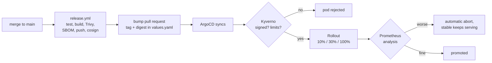

# gitops/

Everything the cluster runs is declared here. After `scripts/bootstrap-gitops.sh`
installs ArgoCD and one root Application, nothing is applied by hand.

| Path | What |
|---|---|
| [`bootstrap/`](bootstrap/) | ArgoCD values: the one install that cannot come from ArgoCD |
| [`apps/`](apps/) | app-of-apps chart, plus `values-{kind,aws,oci}.yaml` per environment |
| [`charts/`](charts/) | one Helm chart per service, built on the shared `service-lib` library chart |
| [`policies/`](policies/) | Kyverno admission policies and their tests |

## From commit to production



A broken image can be stopped at four points:

| Problem | Stopped by |
|---|---|
| critical CVE with a fix available | Trivy, the release fails |
| image not signed by `release.yml` on `main` | Kyverno, the pod is rejected |
| crash loop (F01) | `progressDeadlineAbort`, the rollout aborts after 5 minutes |
| errors or latency worse than the stable release (F02, F03) | canary analysis, the rollout aborts |

## Sync order

The root Application creates child Applications in waves, and each wave waits for
the previous one to be healthy. Argo CD dropped the health check that makes this
work for Applications, so [`bootstrap/argocd-values.yaml`](bootstrap/argocd-values.yaml)
adds it back.

| Wave | What | Why this early |
|---|---|---|
| -3 | kube-prometheus-stack, argo-rollouts, cloudnative-pg, metrics-server | their CRDs and APIs |
| -2 | kyverno | must exist before any policy |
| -1 | policies | must exist before any workload pod |
| 0 | redis, postgres | services need them |
| 1 | catalog | owns the schema |
| 2 | search-api, indexer, gateway | depend on catalog |
| 3 | loadgen | canary analysis needs traffic |

## Canary analysis

Every Rollout runs an AnalysisTemplate from the library chart. Prometheus tells
canary and stable apart through the `rollouts-pod-template-hash` label, which the
PodMonitor copies onto every series. For HTTP services a release fails on:

| Metric | Fails when | Catches |
|---|---|---|
| `traffic` | the canary serves no requests | pods that are up but unreachable |
| `error-rate-increase` | canary 5xx share is over 1 point above stable | F02 |
| `p95-latency` | canary p95 is above 300 ms | an SLO breach |
| `p95-latency-increase` | canary p95 is over 100 ms above stable | F03 |

The last one exists because F03 adds 250 ms, which on a 5 ms service still fits
under the SLO. An absolute threshold alone would promote that release.

The indexer has no request stream, so it fails on `up` and on dead-lettered events.

### Known limits

- **The weights are nominal.** There is no ingress controller or service mesh, so
  Argo Rollouts splits traffic by replica count: `setWeight: 10` on one replica
  means one canary pod beside one stable pod, about 50%. A real 10% needs a
  traffic router, which the plan rules out (no new tools).
- **An aborted release stays in Git.** The stable pods keep serving, but
  `values.yaml` still names the bad image and ArgoCD shows it as Degraded until
  someone reverts. The remediator automates that in week 9.
- **The first deploy skips analysis.** There is no stable release to compare to.
- **The gateway pins connections to its upstreams,** so `loadgen` also calls
  search-api and catalog directly and disables connection reuse. Without that, a
  healthy canary would look like it had no traffic.
- **`release.yml` merges its own bump pull request.** Pull requests opened with
  `GITHUB_TOKEN` do not trigger other workflows, and the digests already passed
  tests, scan and signing, so the canary is the next gate.

## Policies

Enforced in the `shopsearch` namespace:

| Policy | Rule |
|---|---|
| `require-limits` | every container sets CPU and memory limits |
| `disallow-latest` | images have a tag, and it is not `latest` |
| `restrict-registries` | images come from a short allow-list |
| `verify-signatures` | our images are signed by `release.yml` on `main` |

`verify-signatures` only covers our own images, which is why
`restrict-registries` exists: without it, any other registry would skip the check.
`make up` builds images locally, so the kind environment alone also allows the
`incidentlens/` prefix.

Kyverno 1.19 marks `ClusterPolicy` as deprecated in favour of the CEL-based
policy types. These still work on the pinned chart; migrating is a follow-up.

## Checks

```bash
make gitops-lint    # helm lint, kubeconform, kyverno test; no cluster needed
make canary-test    # on a running cluster: promotion, abort, admission
```

Both run in [CI](../.github/workflows/ci.yml) on every pull request.

## Deferred to week 4

- **Alertmanager, Grafana, kube-state-metrics.** Week 3 installs
  kube-prometheus-stack with only Prometheus enabled, because the canary needs it.
- **External Secrets.** The IRSA role exists, but no secret needs it yet:
  CloudNativePG generates the database password. The first real one is the
  alert webhook.
