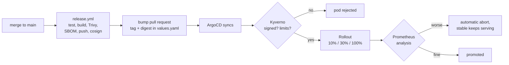
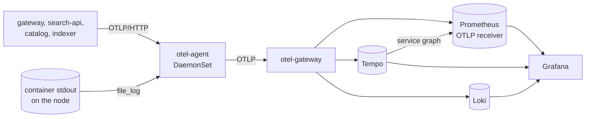

# gitops/

Everything the cluster runs is declared here. After `scripts/bootstrap-gitops.sh`
installs ArgoCD and one root Application, nothing is applied by hand.

| Path | What |
|---|---|
| [`bootstrap/`](bootstrap/) | ArgoCD values: the one install that cannot come from ArgoCD |
| [`apps/`](apps/) | app-of-apps chart, plus `values-{kind,aws,oci}.yaml` per environment |
| [`charts/`](charts/) | one Helm chart per service, built on the shared `service-lib` library chart |
| [`observability/`](observability/) | SLOs (Sloth), alert routing and the Grafana dashboards |
| [`policies/`](policies/) | Kyverno admission policies and their tests |

## From commit to production



A broken image can be stopped at four points:

| Problem | Stopped by |
|---|---|
| critical CVE with a fix available | Trivy, the release fails |
| image not signed by `release.yml` on `main` | Kyverno, the pod is rejected |
| crash loop (F01) | `progressDeadlineAbort`, the rollout aborts after 5 minutes |
| errors or latency worse than the stable release (F02, F03) | canary analysis, the rollout aborts |

## Sync order

The root Application creates child Applications in waves, and each wave waits for
the previous one to be healthy. Argo CD dropped the health check that makes this
work for Applications, so [`bootstrap/argocd-values.yaml`](bootstrap/argocd-values.yaml)
adds it back.

| Wave | What | Why this early |
|---|---|---|
| -4 | the `gp3` StorageClass (EKS only) | Prometheus, Loki and Tempo claim volumes in the next waves |
| -3 | kube-prometheus-stack, argo-rollouts, cloudnative-pg, metrics-server, cert-manager | their CRDs and APIs; cert-manager issues Chaos Mesh's certificates |
| -2 | kyverno, loki, tempo, otel-agent, otel-gateway, sloth, chaos-mesh | admission control and the telemetry backends, before anything sends to them; Chaos Mesh for [chaos/](../chaos/) |
| -1 | policies, observability | policies before any workload pod; SLOs and dashboards before the first request |
| 0 | redis, postgres | services need them |
| 1 | catalog | owns the schema |
| 2 | search-api, indexer, gateway | depend on catalog |
| 3 | loadgen | canary analysis needs traffic |

## Canary analysis

Every Rollout runs an AnalysisTemplate from the library chart. Prometheus tells
canary and stable apart through the `rollouts_pod_template_hash` label: the chart
hands each pod its own hash through the downward API, the SDK sends it as an
OpenTelemetry resource attribute, and Prometheus keeps it as a label. For HTTP
services a release fails on:

| Metric | Fails when | Catches |
|---|---|---|
| `traffic` | the canary serves no requests | pods that are up but unreachable |
| `error-rate-increase` | canary 5xx share is over 1 point above stable | F02 |
| `p95-latency` | canary p95 is above 300 ms | an SLO breach |
| `p95-latency-increase` | canary p95 is over 100 ms above stable | F03 |

The last one exists because F03 adds 250 ms, which on a 5 ms service still fits
under the SLO. An absolute threshold alone would promote that release.

The indexer has no request stream, so it fails when it does not report
`indexer_ready` and when it dead-letters events. Metrics are pushed, so there is
no `up` series to check.

### Known limits

- **The weights are nominal.** There is no ingress controller or service mesh, so
  Argo Rollouts splits traffic by replica count: `setWeight: 10` on one replica
  means one canary pod beside one stable pod, about 50%. A real 10% needs a
  traffic router, which the plan rules out (no new tools).
- **An aborted release stays in Git.** The stable pods keep serving, but
  `values.yaml` still names the bad image and ArgoCD shows it as Degraded until
  someone reverts. The remediator automates that in week 9.
- **The first deploy skips analysis.** There is no stable release to compare to.
- **The gateway pins connections to its upstreams,** so `loadgen` also calls
  search-api and catalog directly and disables connection reuse. Without that, a
  healthy canary would look like it had no traffic.
- **`release.yml` merges its own bump pull request.** Pull requests opened with
  `GITHUB_TOKEN` do not trigger other workflows, and the digests already passed
  tests, scan and signing, so the canary is the next gate.

## Policies

Enforced in the `shopsearch` namespace:

| Policy | Rule |
|---|---|
| `require-limits` | every container sets CPU and memory limits |
| `disallow-latest` | images have a tag, and it is not `latest` |
| `restrict-registries` | images come from a short allow-list |
| `verify-signatures` | our images are signed by `release.yml` on `main` |

`verify-signatures` only covers our own images, which is why
`restrict-registries` exists: without it, any other registry would skip the check.
`make up` builds images locally, so the kind environment alone also allows the
`incidentlens/` prefix.

Kyverno 1.19 marks `ClusterPolicy` as deprecated in favour of the CEL-based
policy types. These still work on the pinned chart; migrating is a follow-up.

## Checks

```bash
make gitops-lint    # helm lint, kubeconform, kyverno test; no cluster needed
make canary-test    # on a running cluster: promotion, abort, admission
```

Both run in [CI](../.github/workflows/ci.yml) on every pull request.

## Observability



| Signal | From the service | Stored in | Kept |
|---|---|---|---|
| traces | OTel SDK, OTLP to the node's agent | Tempo | 7 days |
| metrics | OTel SDK, OTLP, every 15 s | Prometheus, through its OTLP receiver | 7 days, 4 GB |
| logs | JSON lines on stdout, read from the node | Loki, with `trace_id` as structured metadata | 7 days |
| service graph | derived from traces | Prometheus (`traces_service_graph_*`) | 7 days |

The agent runs on every node, so a pod always sends to its own node
(`internalTrafficPolicy: Local`). It also tails the containers' stdout, parses
the JSON, sets severity and trace context, and names the stream after the
container. The gateway collector batches and fans out to the three backends.

### Following a request

Grafana is at http://localhost:3000 on kind (`make grafana` prints the admin
password; anonymous users can view). The **ShopSearch / Service RED**
dashboard has rate, errors and latency per route for one service, then
**Slow requests** (a Tempo query for server spans over a threshold) and the
service's logs. Open a slow trace and expand it: gateway, then catalog, then
the PostgreSQL statement, or search-api and its Redis calls. Each span links
to its logs, and each log line links back to its trace. Latency panels for
search-api and catalog also carry exemplars.

`make obs-test` checks this path end to end, and runs in CI.

### SLOs and alerts

[`observability/files/slos.yaml`](observability/files/slos.yaml) defines four
SLOs at the gateway (availability and latency for search and product lookups).
Sloth turns them into recording rules and multiwindow burn-rate alerts with
`severity: page` or `ticket`. Alertmanager sends those to a Discord or Slack
webhook:

```bash
make alert-webhook URL=https://discord.com/api/webhooks/...
```

Without a webhook the route is rejected and alerts stay visible in Alertmanager
and on the **ShopSearch / SLOs** dashboard. kube-prometheus-stack's own
platform alerts (crash loops, full volumes, and so on) go to the default `null`
receiver; the threshold detector of week 6 is a separate baseline.

### Dashboards

| Dashboard | What |
|---|---|
| ShopSearch / Service RED | rate, errors, latency per route, slow traces, service graph, logs, pod CPU and memory, indexer |
| ShopSearch / SLOs | objective, SLI, error budget left, burn rate per window, firing alerts |
| IncidentLens / Cost estimate | requested vs used CPU and memory per namespace, priced at AWS list prices |

They are JSON files in [`observability/files/dashboards/`](observability/files/dashboards/),
loaded by Grafana's sidecar. Grafana does not allow saving changes to them:
export the edited dashboard as JSON and commit it.

### Not done yet

- **External Secrets.** The bootstrap script creates the two secrets (Grafana
  admin, alert webhook). External Secrets with AWS Secrets Manager waits for the
  first recorded EKS session, where it can be tested.
- **Loki on S3.** The bucket and IRSA role exist in Terraform; Loki uses a local
  volume until the same EKS session.
