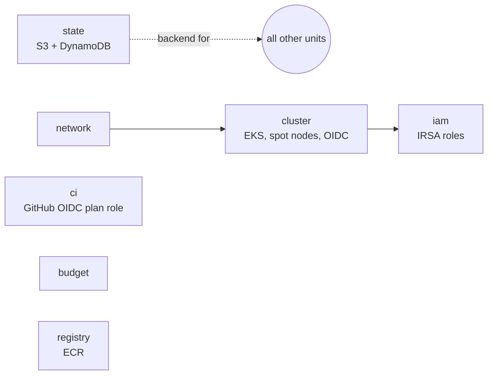

# infra/

Infrastructure as code. Three environments share one workflow, and only one of
them costs money.

| Path | What |
|---|---|
| [`kind/cluster.yaml`](kind/cluster.yaml) | local kind cluster, used by `make up` and by the `dev` environment |
| [`modules/aws/`](modules/aws/) | `state`, `network`, `cluster`, `registry`, `iam`, `budget`, `ci` |
| [`modules/oci/`](modules/oci/) | `state`, `k3s` (one Always Free Ampere A1 VM) |
| [`modules/kind/`](modules/kind/) | wraps the kind CLI for the `dev` environment |
| [`live/`](live/) | Terragrunt units: `dev` (kind), `aws` (EKS, recorded sessions only), `oci` (always-on demo) |

## Module boundaries



Each boundary is a lifecycle: `network` and `cluster` come and go with every
session, `state`, `budget` and `ci` stay. That is why `make destroy` can leave
the last three alone.

## What was verified, and what was not

| Check | Status |
|---|---|
| `terraform validate`, `terraform test` on mocked providers | passes offline, in CI ([`infra.yml`](../.github/workflows/infra.yml)) |
| `terraform fmt`, `tflint`, `checkov` | passes in CI; every checkov skip has its reason next to it in the code |
| `terragrunt hcl validate`, rendering each unit | passes in CI |
| `terraform apply` on AWS or OCI | **not run yet**: it needs a credit-funded session |
| "builds from zero in under 25 minutes, destroys cleanly" | **not measured yet** |

Mocked tests prove the logic of the modules: who can assume which role, which
ports are open, that nodes are spot. They cannot prove that AWS accepts a
combination of settings. Only a real apply does, so the timing claim stays open
until a recorded run exists.

## Offline checks

```bash
make infra-test    # terraform validate and test for every module
make infra-lint    # fmt, tflint, checkov
```

No credentials and no cloud account needed.

## An AWS session

The cloud cluster exists only while you use it, about 1 EUR per hour all in.

```bash
export ADMIN_CIDR="$(curl -fsS https://checkip.amazonaws.com)/32"
export BUDGET_ALERT_EMAIL=you@example.com

make cloud-bootstrap   # once per account: state, budget alerts, CI role
make cloud-plan        # look before you spend
make cloud             # EKS plus ArgoCD
make destroy           # always, and it proves nothing billable is left
```

`make destroy` removes what Kubernetes created first (load balancers, volumes),
because Terraform does not know about them and they would keep the VPC alive.
It then asks AWS directly through `scripts/verify-destroyed.sh`, and fails if an
EKS cluster, instance, NAT gateway, elastic IP, load balancer or tagged volume
remains. Run that check alone with `make verify-destroyed`.

Budget alerts fire at 20 and 50 USD of actual spend. A budget alerts, it does
not stop anything.

## Real plans on pull requests

`infra.yml` comments on every infra pull request. By default the comment holds
the offline results. For a real `terraform plan`, after `make cloud-bootstrap`:

```bash
cd infra/live/aws/ci && terragrunt output -raw plan_role_arn
gh variable set AWS_PLAN_ROLE_ARN --body '<that ARN>'
```

The role is reached through GitHub OIDC, so no access keys are stored. It can
read the account and take the state lock, and it cannot change anything.

## The OCI demo

```bash
export ADMIN_CIDR="$(curl -fsS https://checkip.amazonaws.com)/32"
export OCI_COMPARTMENT_OCID=ocid1.compartment.oc1..xxx
export OCI_NAMESPACE=your-namespace
export SSH_PUBLIC_KEY="$(cat ~/.ssh/id_ed25519.pub)"

(cd infra/live/oci/state && terragrunt run -- apply)
(cd infra/live/oci/k3s && terragrunt run -- apply)
```

Authentication comes from `~/.oci/config`. A1 capacity is sometimes unavailable
in busy regions, in which case `apply` fails and has to be retried.

## Decisions worth defending

- **Own modules, not `terraform-aws-modules`.** The point of the project is to
  be able to explain every resource.
- **Single NAT gateway and spot nodes.** Cost over availability, acceptable for
  a cluster that exists for hours.
- **DynamoDB locks.** Terraform 1.11+ offers S3-native locking (`use_lockfile`)
  and marks `dynamodb_table` as deprecated. The plan names DynamoDB, and it
  still works, but this is the first thing to modernise.
- **Log group created by Terraform.** Left to EKS, it never expires and it
  survives `destroy`, a small permanent bill.
- **Access entries, not `aws-auth`.** The ConfigMap is the legacy path.
- **`AWS_ACCOUNT_ID` from the environment.** Terragrunt's `get_aws_account_id()`
  calls STS while parsing, so even `hcl validate` would need credentials.
